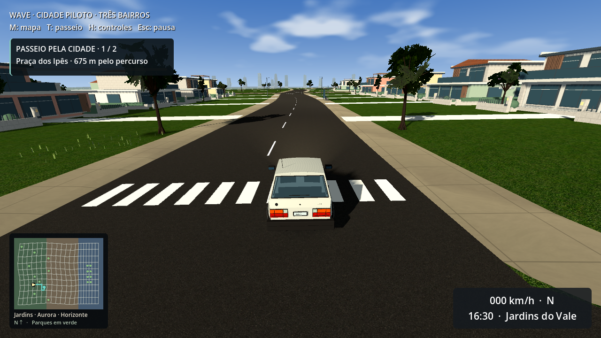
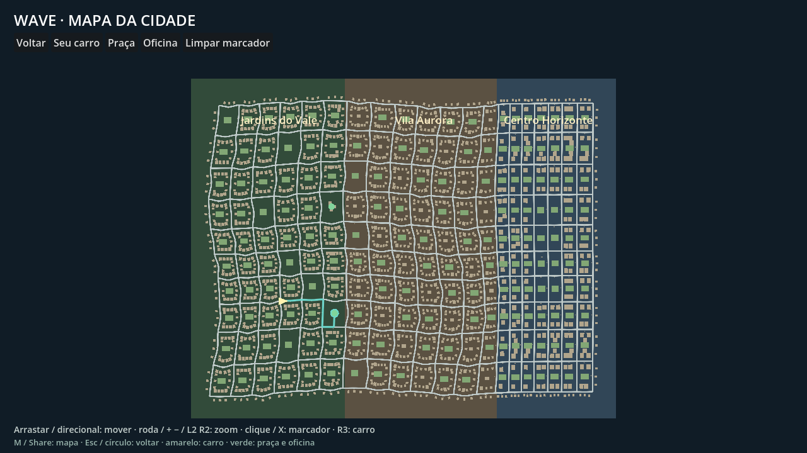

# Consolidação da cidade piloto — 2026-10-10

A revisão mantém os 200 quarteirões e os três bairros, concentra o trabalho na cidade piloto e corrige os custos estruturais encontrados na análise. Há um passeio opcional entre a praça e a oficina, com orientação no mapa e chegadas verificadas por estacionamento real.

## Pontos tratados

| Problema | Correção e evidência |
| --- | --- |
| Malhas globais impediam descarte por visão | Terreno, ruas, calçadas, pintura e pavimentos divididos em tiles de 128 m. Triângulos existentes são distribuídos inteiros; apoio físico acompanha cada tile. Não se recorta ou simplifica o piso dirigível. |
| Numeração extrudida custava 3.221.900 triângulos | Atlas original de dez dígitos, seis vértices por dígito e MultiMesh por área de 64 m, visível até 55 m. Endereços e posições preservados. |
| Carros estacionados reutilizavam o modelo completo | 813 carros em três malhas compartilhadas, uma superfície opaca, menos de 400 triângulos por carro, incluindo rodas, vidros e óticas. O carro do jogador e as colisões dos estacionados preservados. |
| Residência física muito alta | Correntes de boxes nos muros substituídas por envelopes convexos locais. Ruas, guias e terreno mantêm suas faces de apoio. |
| Detalhe de materiais dependia do MSAA | Nova opção persistente independente; migração conserva a aparência anterior. Econômico desliga detalhe; Equilibrado e Qualidade ligam. |
| HUD extenso e distrações de outros mapas | Tela curta com velocidade, marcha, hora e bairro; H/direcional esquerdo mostra controles completos. Pausa prioriza passeio e mapa. |
| Cidade sem atividade | T/direcional superior inicia/cancela praça → oficina. Rota usa a rede conectada, inclui acessos e saída de ré, exige apoio, ≤2 km/h e dois segundos parado; pausa, reset, teleporte, cancelamento e repetição testados. |
| Repetição de fachadas e vazios | Mais variação de telhados, janelas e painéis; reboco nas variantes de cor; jardins internos com caminhos e canteiros. |
| Desempenho da expansão sem comparação | Runner antes/depois no PCK, mesma fixture e rota nos três bairros, foco e telemetria auditáveis. A retomada registra diagnóstico com uma passagem por GPU; o modo controlado oferece três passagens e sessão prolongada. |

## Estrutura

| Medida | Antes (gerador 9) | Depois (gerador 10) |
| --- | ---: | ---: |
| Nós | 74.875 | 47.644 |
| Formas de colisão | 51.702 | 20.752 |
| Recursos da cidade salvos | 133.894.831 bytes | 118.034.903 bytes |
| Terreno: malhas | 1 | 480 |
| Ruas: malhas | 1 | 390 |
| Calçadas: malhas | 1 | 397 |
| Piso distante: malhas | 0 | 132 |
| Piso distante: triângulos | 0 | 180.719 |

As superfícies próximas têm LODs visuais de índices gerados offline e alcance de 220 m. O piso distante permanece residente; as malhas e colisões completas continuam preservadas. O inventário e os hashes foram atualizados para essa versão. Contagens estruturais não são objetos visíveis por quadro. [Inventário comparado](structural-comparison.json) e [tamanhos dos recursos](resource-sizes-after.json). O alocador estático da Godot, o RSS do processo e bytes em disco são medidas distintas. Tempos dos inventários headless não são benchmark controlado de carregamento.

## Validação funcional

**857 verificações Godot no projeto, 14 testes Python e 401 verificações de comportamento no PCK passaram.** A regeneração final adicional aprovou três verificações de preservação de geometria e colisões.

A regeneração revelou 36 malhas distantes de calçadas antigas embutidas nos setores. Os recursos foram sincronizados com a geração nova e os setores passaram a usar essas malhas externas. A comparação agora também inclui os índices dos LODs.

Os runners foram retomados depois de corrigir interferência do controle físico nas fixtures e uma espera de frenagem insuficiente. A isolação usa um dispositivo sintético reservado apenas aos testes; comandos do jogo continuam normais. [Suítes e contagens](functional-checks.json), [logs](test-logs/).

Linux release abriu em execução headless. Recursos Linux e Windows têm o mesmo SHA-256 `c197ac71e440757ea4fab959175da4b39f9f7078a3e50448748d6372acce590a`. A validação do PCK usa a Godot 4.7.2 com fixture externa; execução nativa Windows permanece pendente.

O teste `pilot_city_smoke.gd` aceita `--regenerated-scene=user://pilot-city-regenerated.scn` para retomar uma geração já concluída. É necessário manter o `XDG_DATA_HOME` daquela geração e a mesma versão do gerador. A execução padrão continua regenerando a cidade inteira; qualquer divergência encerra o teste antes dos percursos.

A fixture de benchmark também foi corrigida: dividir rotas independentes eliminava as curvas nos cruzamentos. Agora os trechos compartilham pontos de uma única rota arredondada; os 14 trechos passaram na verificação funcional tanto no projeto atual quanto no pacote anterior. [Tentativa intermediária preservada](benchmark/intermediate-route-v2/README.md).

## Desempenho renderizado

A medição desta retomada tem escopo de **diagnóstico**, conforme solicitado pelo usuário: sem declaração de uso exclusivo, três repetições ou sessão prolongada. Esse escopo permite comparar o comportamento observado, mas mantém pendente a validação controlada dos perfis de desempenho.

As quatro passagens renderizadas estão em execução. As tabelas e os dados brutos finais serão anexados ao concluir o diagnóstico; as tentativas intermediárias já estão preservadas.

## Inspeção visual

[Galeria antes/depois](index.html), [contexto das capturas finais](preview-context-after.json) e [fixture reproduzível](preview-fixture-after.gd.txt). Spawn e HUD usam a câmera jogável. Vistas de arquitetura desativam névoa e limites de distância para inspeção estática; imagens noturnas restauram essas opções. Capturas não substituem avaliação humana de arte e condução.

## Escopo e limites

A cidade continua carregada inteira. Partição para descarte por visão e envelopes locais não são streaming de residência. A máquina tem 16 GB: RSS monitorado não certifica o requisito de 8 GB. Windows foi exportado; execução nativa e avaliação humana permanecem etapas próprias. Dois avisos de textura no encerramento gráfico aparecem também no PCK anterior; não foram introduzidos pela revisão.
