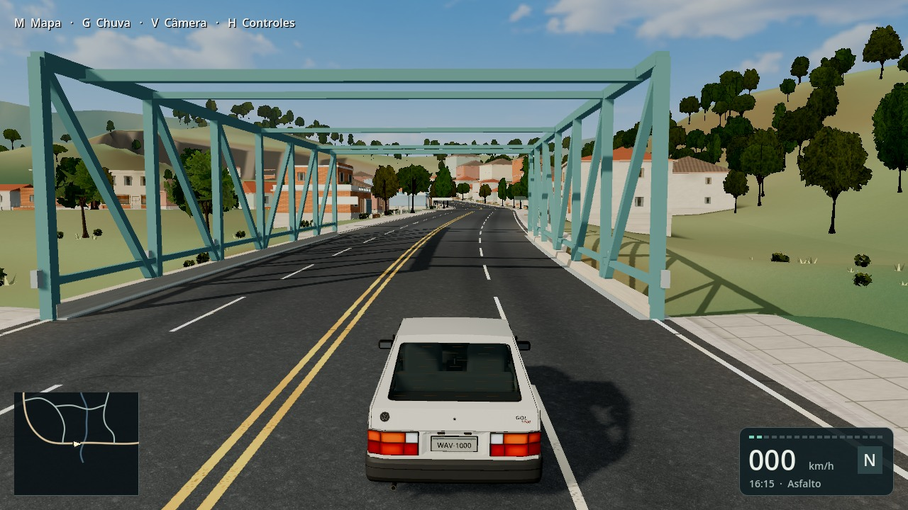

# Baixada do Arroio

A Baixada se conecta à Vila das Figueiras por três encontros na Estrada do Vale. Uma avenida de quatro faixas contorna as duas margens. A Rua da Fábrica serve a antiga fiação, a Alameda do Canal liga a baixada ao Vale e a Travessa da Usina costura as duas margens pelo pátio de carga. São **1.555 m de novas vias**. O terreno físico passou de **0,719 para 0,919 km²**, um acréscimo de **27,9%**. A ampliação fica ao sul da cena que abre ao iniciar o Wave.

## Referências de jogabilidade e direção de arte

O estudo usou manuais, apresentações dos desenvolvedores, registros de produção, trailers e imagens oficiais. A avaliação de condução ocorreu no Wave, por meio de percursos com o carro e a câmera do jogo.

| Referência | Leitura de jogabilidade | Leitura gráfica e aplicação no Wave |
| --- | --- | --- |
| **Need for Speed: Most Wanted** (2012), **Heat** e **Unbound** | Fairhaven apresenta a corrida como uma atividade da mesma rede usada na exploração. Em *Heat*, a equipe discute como o drift obrigatório reduz a variedade de linhas e como a sensação de velocidade depende do conjunto de câmera e controles. Na Baixada, uma linha limpa e a freada antes das curvas produzem tempo competitivo. | A arte de *Unbound* faz o jogador distinguir efeitos do carro, contorno da estrada e cidade em profundidades diferentes. A Travessa usa sombra contínua da cobertura, concreto mais claro e luzes no eixo da rua para fazer a saída aparecer antes da curva. A avenida alterna faixa ampla, treliças que passam perto da câmera e fachadas ao longo da subida. [Criterion, Fairhaven](https://news.ea.com/press-releases/press-releases-details/2012/Criterion-Games-Reinvents-Best-Selling-Need-for-Speed-Most-Wanted/default.aspx) · [Ghost Games, dirigibilidade em Heat](https://www.ea.com/games/battlefield/news/under-the-hood-the-handling-model) · [Criterion, direção de arte de Unbound](https://www.ea.com/games/need-for-speed/need-for-speed-unbound/news/the-world-is-your-canvas?isLocalized=true) |
| **Midnight Club: Los Angeles** | Provas ordenadas e livres fazem o jogador ler a mesma cidade de formas diferentes. Na modalidade livre descrita pela Rockstar, a ordem dos checkpoints é uma decisão de corrida. A Baixada aplica o princípio com três pontos bidirecionais e uma chegada que só abre após a coleta dos três. | Avenidas e pátios ferroviários no material de *South Central* têm silhuetas e espaços reconhecíveis em alta velocidade. Na Baixada, a chaminé ajuda a localizar a fiação, a travessa coberta aponta o atalho e a treliça marca a travessia longa. Cada marco pertence a um trecho que se pode dirigir. [Rockstar, manual de Los Angeles Complete Edition](https://media.rockstargames.com/rockstargames-newsite/img/manuals/en_us/MC_LA_CE_360_CLASSICS_MANUAL_ENG.pdf) · [Rockstar, trailer South Central](https://www.rockstargames.com/videos/t26rc77k) |
| **Assetto Corsa** e **Competizione** | A estreita correspondência entre superfície, carga e retorno da direção torna uma mudança de pavimento relevante. O princípio aplicado ao Gol é o de usar a mesma superfície visual para a consulta de contato. As rodas que cruzam o concreto coberto registram aderência e umidade próprias, enquanto as que já saíram voltam a receber o piso exposto. | Na imagem oficial de área de boxes molhada, o reflexo depende de luz, incidência e superfície. Na Usina, a cobertura limita o filme de água, o concreto tem textura em escala própria e na saída a pista volta a refletir o céu e os postes. A geometria visível do tabuleiro e o piso de apoio são gerados juntos. [Kunos, Assetto Corsa](https://assettocorsa.gg/assetto-corsa/) · [Kunos, Competizione](https://assettocorsa.gg/assetto-corsa-competizione/) |
| **Forza Horizon 5** e **Forza Motorsport** | As mudanças de relevo e os túneis de Guanajuato dão funções diferentes a trechos próximos. A Baixada usa uma artéria rápida, travessas mais estreitas, um ponto de decisão junto à Fiação e uma subida de saída. A documentação da Turn 10 reforça a importância de transições previsíveis quando rodas recebem pisos diferentes. | A produção de *Horizon 5* usa referências locais, módulos urbanos, interiores sugeridos e materiais que mudam com a umidade. A Baixada reutiliza caixilhos, telhados e elementos de rua para montar galpões, habitação operária e sobrados em escalas diferentes. Bosques de borda e neblina dão continuidade à paisagem para além da rua. [Playground Games, biomas](https://news.xbox.com/en-us/2021/07/26/exploring-the-biomes-and-seasons-of-forza-horizon-5/) · [Simon Hughes, módulos de Guanajuato](https://simonhughes3d.artstation.com/projects/RnEYRD) · [Turn 10, pneus](https://forza.net/news/forza-motorsport-drivatars-tire-physics) |

A Fiação do Arroio usa as tipologias de tijolo aparente, caixilhos metálicos, aberturas largas e chaminés documentadas em fábricas brasileiras. A rua, a torre d’água, os pátios e as pontes têm implantação própria para o relevo do Wave. [IPHAN, Fábrica de Tecidos São Luiz](https://www.gov.br/iphan/pt-br/acesso-a-informacao/participacao-social/conselhos-e-orgaos-colegiados/banco-de-pareceres/tombamento/parecer-tombamento-fabrica-de-tecidos-sao-luiz-itu-sp-damiane-santos.pdf) · [Prefeitura do Rio, Fábrica Bangu](https://rio.rj.gov.br/dlstatic/10112/6439681/4172806/olhosdeversuburbio.compressed.pdf)

## O que muda ao dirigir

| Trecho | Geometria e pilotagem |
| --- | --- |
| Avenida da Baixada · 915 m | Quatro faixas em 14,4 m, curva aberta na descida, travessia em treliça e retomada em subida nos sobrados. O perfil tem 18,2 m de variação de cota. |
| Rua da Fábrica · 227 m | Pórticos, torre d’água e pátios orientam a decisão entre a avenida e a Usina. O trecho interno pede reduzir antes da bifurcação. |
| Alameda do Canal · 253 m | A ligação central com o Vale costura a margem leste e permite chegar à avenida ou voltar pelo atalho. |
| Travessa da Usina · 160 m | Largura de 8 m, teto da plataforma de carga e transição de concreto protegido para asfalto exposto. A segunda ponte dá uma alternativa mais curta, com a saída mais fechada. |

**M / Share** abre o mapa. A **Avenida da Baixada** tem prova cronometrada com trajeto fixo. Na **Rota Livre do Arroio**, o mapa mostra a Fiação, a Ponte da Usina e o Canal. Colete os três em qualquer ordem e depois cruze a chegada leste. Os dois eventos guardam recorde limpo e fantasma, separados por condição de pista. A condução livre tem quatro veículos circulando pelo anel da Baixada e pelo Vale, além do tráfego da Vila.

O minimapa acompanha a posição do Gol em escala local. O mapa de atividades mostra toda a cidade. Ao marcar a largada, o caminho aparece no minimapa. Na prova livre, os checkpoints visitados mudam de cor e a marca pendente mais próxima aparece na rua. **G / direcional direito** alterna a chuva.

## Materiais e renderização

A Fiação tem volumes em tijolo, caixilhos industriais, telhados em dentes de serra, chaminé e a torre d’água sobre estrutura treliçada. As margens usam aterros, vegetação ribeirinha e bosques agrupados. A iluminação ganha sol mais quente ao baixar, preenchimento mais frio nas fachadas e transições de névoa distintas no seco e na chuva. No perfil com detalhes de materiais, o asfalto também tem fissuras seladas visíveis junto ao carro.

As texturas originais foram criadas na ferramenta integrada ImageGen. Os prompts completos acompanham os arquivos de origem. [Tijolo da Fábrica](../../../../assets/textures/figueiras/tijolo-da-fabrica.provenance.json) · [Concreto da Usina](../../../../assets/textures/figueiras/concreto-da-usina.provenance.json)

## Capturas do jogo

As imagens foram renderizadas no perfil Equilibrado, em 1280 × 720, na Radeon R7 M260. As duas comparações usam a mesma posição, direção e horário da câmera.

- [Baixada vista do Vale antes](vista-vale-antes.jpg) · [Depois](vista-vale.jpg)
- [Avenida de entrada antes](avenida-antes.jpg) · [Depois](avenida.jpg)
- [Subida dos sobrados](sobrados.jpg) · [Bifurcação da Fiação](fiacao.jpg) · [Travessa no seco](travessa.jpg) · [Travessa com chuva](travessa-chuva.jpg)
- [Mapa da Rota Livre do Arroio](mapa.jpg)

## Validação

Na prova da Avenida da Baixada, o Gol percorreu a largada, os parciais e a chegada em **46,85 s**, com máxima de **75 km/h**, **349 passos de frenagem** e apoio contínuo. O teste das quatro vias amostra o centro e as duas linhas laterais a cada 4 m. A maior diferença entre a altura prevista e a colisão foi de **0,16 m**. As duas pontes têm apoio para o carro e colisão independente no leito. O GPS chega às quatro vias a partir da largada original. A prova livre foi exercitada com chegada antecipada, checkpoint no sentido inverso e ordem 3–1–2. Em uma condução contínua pelo trajeto Fiação → Usina → Canal, o Gol completou a prova limpa em **1 min 37,99 s**. [Teste da Baixada](../../../../tests/figueiras_baixada_smoke.gd)

Seis suítes focadas da Vila concluíram **141 verificações**, incluindo Copa e fantasmas, direção, tráfego, clima, câmera e superfícies. A suíte longa de travessias atingiu o limite de execução sob carga concorrente.

A cena foi gerada no Godot 4.7.2. Linux e Windows receberam o mesmo pacote de recursos, que passou as 12 verificações da Baixada diretamente no PCK. A validação gráfica foi feita no Linux e incluiu a leitura do minimapa no extremo sul.

Foram feitas passagens renderizadas com os pacotes, na Radeon R7 M260, em X11, no Equilibrado, a 1280 × 720 e com o tráfego desligado. A distância simulada na avenida variou de 59 a 99 m dentro da mesma janela de coleta de dez segundos. A carga concorrente da máquina variou entre as passagens. Os resultados ficam como diagnóstico e a comparação de FPS permanece inconclusiva. [Medições brutas](medicoes.json) · [Script de benchmark](../../../../tests/figueiras_benchmark.gd)
